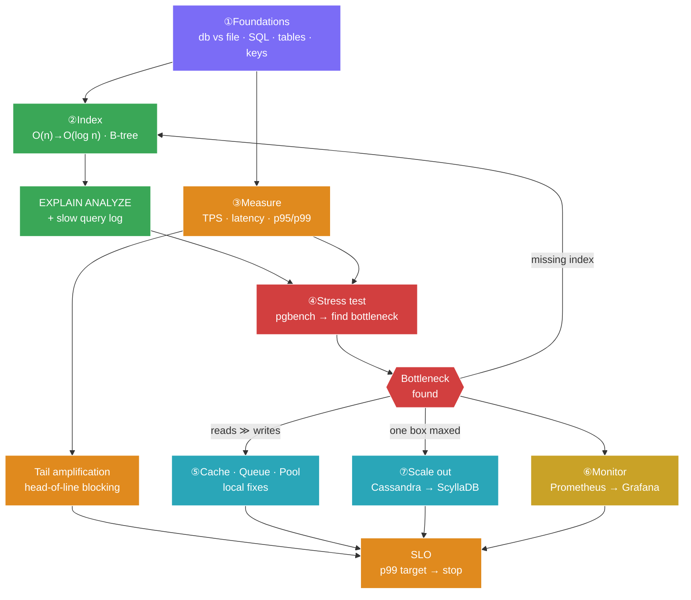
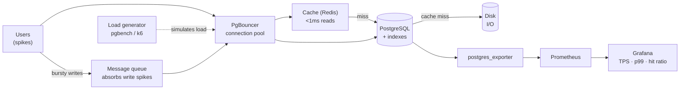
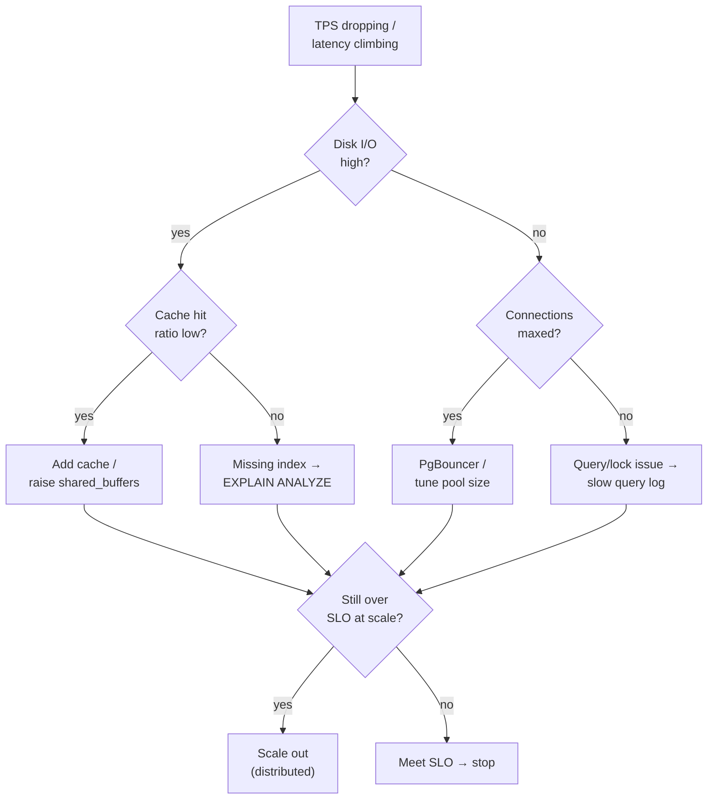

# Learning Path & System Map

Two views of the same knowledge. Open in Obsidian (reading mode) to render the diagrams.
For the draggable, note-embedded version see [[knowledge-map.canvas|the Canvas map]].

## 1 · Concept dependency path

What to understand before what — follow the arrows.

## 2 · The system you're stress-testing

Where every concept physically sits in the request path.

## 3 · The decision: which fix?

---
**Related:** [[index]] · [[challenge]] · [[knowledge-map.canvas]]
